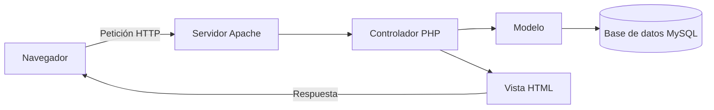

# BiblioApp


Aplicación web para gestionar los préstamos de libros de la biblioteca de un centro educativo.


## Índice

- [Descripción](#descripción)
- [Características](#características)
- [Tecnologías](#tecnologías)
- [Instalación](#instalación)
- [Arquitectura](#arquitectura)
- [Tareas pendientes](#tareas-pendientes)
- [Preguntas frecuentes](#preguntas-frecuentes)
- [Historial de cambios](#historial-de-cambios)
- [Licencia](#licencia)

## Descripción

**BiblioApp** permite registrar libros, socios y préstamos desde el navegador. Está pensada para
bibliotecas *pequeñas*, como la de un instituto, donde ~~una hoja de cálculo~~ ya no es suficiente.

El proyecto sigue el patrón MVC[^1] y guarda los datos en una base de datos relacional[^2].

> Una biblioteca organizada es una biblioteca que se usa.

### Imagen externa


## Características

- Gestión de libros
  - Alta, edición y baja
  - Búsqueda por título, autor o ISBN
- Gestión de socios
- Control de préstamos
  - Fecha de devolución automática
  - Avisos de retraso por correo

## Tecnologías

| Capa | Tecnología | Versión |
| :--- | :--- | ---: |
| Backend | PHP | 8.2 |
| Frontend | HTML, CSS y JS | - |
| Base de datos | MySQL | 8.0 |
| Servidor | Apache | 2.4 |

## Instalación

Pasos para ejecutar el proyecto en local:

1. Clonar el repositorio.
2. Instalar las dependencias con Composer.
3. Copiar el archivo de configuración de ejemplo.
4. Arrancar el servidor de desarrollo.

```bash
git clone https://github.com/TU-USUARIO/biblioapp.git
cd biblioapp
composer install
cp .env.example .env
php -S localhost:8000 -t public
```

Para comprobar que PHP funciona se puede usar `php -v` en la terminal.

Ejemplo de la clase que representa un libro:

```php
<?php

class Libro
{
    public function __construct(
        public string $titulo,
        public string $autor,
        public string $isbn
    ) {}
}
```

> [!NOTE]
> La aplicación necesita PHP 8.2 o superior.

Antes de subir cambios al repositorio, ten en cuenta lo siguiente:

> [!WARNING]
> No subas nunca el archivo `.env` al repositorio, contiene las contraseñas de la base de datos.

Y un consejo para producción:

> [!TIP]
> Usa `composer install --no-dev` en el servidor de producción.

## Arquitectura



## Tareas pendientes

- [x] Diseñar la base de datos
- [x] Crear el formulario de login
- [x] Registrar libros y socios
- [ ] Añadir la recuperación de contraseña
- [ ] Enviar avisos de retraso por correo
- [ ] Desplegar en producción

## Preguntas frecuentes

<details>
<summary>¿Qué necesito para instalar la aplicación?</summary>

- PHP 8.2
- MySQL 8.0
- Apache 2.4 con mod_rewrite
- Composer

</details>

<details>
<summary>¿Puedo usar otra base de datos?</summary>

Sí, cualquier base de datos compatible con PDO, por ejemplo **MariaDB** o **PostgreSQL**.
Solo hay que cambiar los datos de conexión en el archivo `.env`.

</details>

<details>
<summary>¿Cómo informo de un error?</summary>

Abre una *issue* en GitHub siguiendo las normas de [CONTRIBUTING.md](CONTRIBUTING.md).

</details>

## Historial de cambios

Todos los cambios de cada versión están en el archivo [CHANGELOG.md](CHANGELOG.md).

## Contribuir

Las normas para colaborar están en [CONTRIBUTING.md](CONTRIBUTING.md).

## Autoría

Esmeralda Sánchez - 2º DAW

## Licencia

Este proyecto se distribuye bajo la licencia MIT. Ver [LICENSE](LICENSE).

He elegido **MIT** porque es la licencia más sencilla y permisiva: cualquier persona puede usar,
copiar, modificar e incluso vender el código, con la única condición de mantener el aviso de
copyright. Para un proyecto educativo es ideal, porque no pone trabas a que otros aprendan de él.
No he elegido GPL v3 porque obligaría a publicar las obras derivadas con la misma licencia, y
Apache 2.0 añade una protección de patentes que este proyecto no necesita.

[^1]: Modelo-Vista-Controlador: separa los datos, la interfaz y la lógica.
[^2]: En concreto MySQL 8.0, aunque funciona con cualquier base de datos compatible con PDO.
